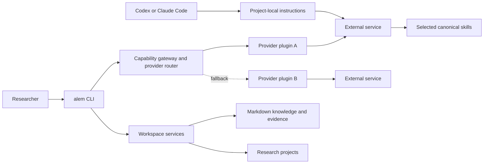

# Architecture

Alem is a local-first research workspace with a deliberately small Python core. Research content,
provider implementations, and agent-facing instructions are replaceable modules around that core.

## System boundaries

The core owns workspace discovery, guarded local state, configuration, validation, lifecycle
commands, and the versioned extension contract. It does not own an academic database, coding agent,
model provider, or hosted catalogue.

The checked-in `integrations/registry.toml` is the release eligibility source of truth. A plugin is
automatically provisioned only when that registry marks its exact version and SHA-256 tree digest
as `accepted`. Authorship (`alem-official` or `community-contributor`) is attribution metadata;
both authorship classes use the same provisioning, readiness, and routing policy. Legacy registry
entries and catalogue-only discoveries migrate as candidates and are never auto-installed.

`alem setup` and `alem update` reconcile accepted releases into immutable, content-addressed paths
under `.alem/plugins/`, record release and author metadata in workspace-local state, verify the
source digest, and enable the reviewed release. Repeated reconciliation is idempotent. A previous
release is retained for rollback; an explicit pin prevents update reconciliation from replacing it.
The registry change is the maintainer acceptance action. `.github/CODEOWNERS` requests maintainer
review of the registry, catalogue, and plugin source; repository settings must require code-owner
approval for that review to be enforced. The checked-in digest proves content identity; it is not
by itself a cryptographic signature or an OS security boundary.

## Progressive context boundary

Installation does not imply context exposure. In lazy mode, coding agents discover only the Alem
router. The router asks the local index for a bounded plan, reads only the selected canonical skill
files, and invokes integrations through one capability gateway. Provider code stays outside model
context. See [`context-routing.md`](context-routing.md).

Research outputs cross integration boundaries as contract-validated JSON or typed artifact
references. See [`capability-contracts.md`](capability-contracts.md). Workflow state and human
decisions remain durable project files; see [`workflow-runtime.md`](workflow-runtime.md).

## Stable and replaceable surfaces

| Surface | Stability | Location | Rule |
| --- | --- | --- | --- |
| Extension API v1 | Public, versioned | `src/alem/extensions/api.py` | Plugins may import only documented exports |
| Plugin manifest v1 | Public, versioned | `plugin.toml` | Unknown fields fail validation |
| Workspace schema v1 | Public configuration | `alem.toml` | Migrations are required for breaking changes |
| CLI | User-facing | `alem` / `alem.ps1` | Commands report implemented state truthfully |
| Runtime internals | Private | other `src/alem/**` modules | May evolve within a minor release |
| Context plan v1 | Persisted runtime state | `.alem/state/context/` | Task-scoped and regenerable |
| Artifact envelope v1 | Public project record | `projects/*/provenance/artifacts/` | Additive metadata evolution only |
| Workflow run v1 | Public project record | `projects/*/provenance/workflow-runs/` | Human gates remain explicit |
| Skills and workflows | Content | `skills/`, `workflows/` | Canonical files are independent of agent adapters |

## Capability routing

Workflows request a capability such as `academic_search`; they never import OpenAlex or Semantic
Scholar directly. The registry discovers enabled providers from validated manifests. The router
orders an explicit user default, configured fallbacks, then remaining providers by manifest
priority. Provider failures are recorded and the next approved provider is tried. The final result
identifies the provider used and preserves failures for provenance.

Adding a provider therefore means adding a plugin, not editing a workflow. See
[`plugin-development.md`](plugin-development.md) for the manifest and public protocol.

Accepted providers remain listed when credentials, hardware, a managed runtime, or an external
service is unavailable. `alem tools list`, `status`, and `doctor` report availability separately
from readiness. Routing skips blocked providers, prefers a ready compatible provider, and records
why a preferred provider was skipped. If none can run, it returns a diagnostic routing error;
research workflows must not interpret that as evidence or a successful empty result.

## Local state and trust

Committed files define reproducible configuration and templates. Mutable state lives in `.alem/`
inside the repository and is ignored by Git. Research projects and exports are also ignored by
default because they may be private.

Local candidate code has separate installation and execution approval gates. Accepted code passes
maintainer review and is provisioned with approval for its exact release digest. Alem executes
plugins in a separate process, but the current release does **not** provide a hardened operating-system
sandbox. Approval, manifests, and process separation are not security isolation. Review
[`plugin-security.md`](plugin-security.md) before enabling third-party code.

Maintainer acceptance is a distribution and trust decision that permits the normal setup/update
path to execute the reviewed release. It does not make contributor code sandboxed or make its
research claims endorsed. Candidate plugins remain excluded from reconciliation and routing.

## Coding-agent compatibility

`AGENTS.md` is the shared instruction entry point and `CLAUDE.md` contains only Claude-specific
loading guidance. Canonical skill content is kept once in `skills/`. `alem setup` generates small
discovery adapters in `.agents/skills/` and `.claude/skills/`; adapters point back to the canonical
file and are safe to regenerate. No command writes to `~/.codex`, `~/.claude`, or `~/.agents`.

The repository can verify files, the lazy router, and adapter structure automatically. Actual loading by each agent
must still be confirmed using the manual compatibility checks before a release.
