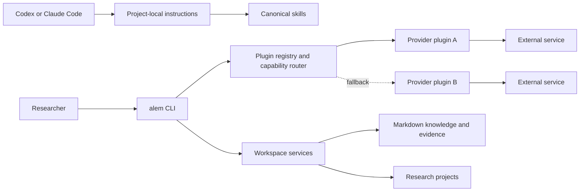

# Architecture

Alem is a local-first research workspace with a deliberately small Python core. Research content,
provider implementations, and agent-facing instructions are replaceable modules around that core.

## System boundaries

The core owns workspace discovery, guarded local state, configuration, validation, lifecycle
commands, and the versioned extension contract. It does not own an academic database, coding agent,
model provider, or hosted catalogue.

## Stable and replaceable surfaces

| Surface | Stability | Location | Rule |
| --- | --- | --- | --- |
| Extension API v1 | Public, versioned | `src/alem/extensions/api.py` | Plugins may import only documented exports |
| Plugin manifest v1 | Public, versioned | `plugin.toml` | Unknown fields fail validation |
| Workspace schema v1 | Public configuration | `alem.toml` | Migrations are required for breaking changes |
| CLI | User-facing | `alem` / `alem.ps1` | Commands report implemented state truthfully |
| Runtime internals | Private | other `src/alem/**` modules | May evolve within a minor release |
| Skills and workflows | Content | `skills/`, `workflows/` | Canonical files are independent of agent adapters |

## Capability routing

Workflows request a capability such as `academic_search`; they never import OpenAlex or Semantic
Scholar directly. The registry discovers enabled providers from validated manifests. The router
orders an explicit user default, configured fallbacks, then remaining providers by manifest
priority. Provider failures are recorded and the next approved provider is tried. The final result
identifies the provider used and preserves failures for provenance.

Adding a provider therefore means adding a plugin, not editing a workflow. See
[`plugin-development.md`](plugin-development.md) for the manifest and public protocol.

## Local state and trust

Committed files define reproducible configuration and templates. Mutable state lives in `.alem/`
inside the repository and is ignored by Git. Research projects and exports are also ignored by
default because they may be private.

Third-party code has two approval gates: installation and execution. Alem executes plugins in a
separate process, but the foundation release does **not** provide a hardened operating-system
sandbox. Approval, manifests, and process separation are not security isolation. Review
[`plugin-security.md`](plugin-security.md) before enabling third-party code.

## Coding-agent compatibility

`AGENTS.md` is the shared instruction entry point and `CLAUDE.md` contains only Claude-specific
loading guidance. Canonical skill content is kept once in `skills/`. `alem setup` generates small
discovery adapters in `.agents/skills/` and `.claude/skills/`; adapters point back to the canonical
file and are safe to regenerate. No command writes to `~/.codex`, `~/.claude`, or `~/.agents`.

The repository can verify files and adapter structure automatically. Actual loading by each agent
must still be confirmed using the manual compatibility checks before a release.
